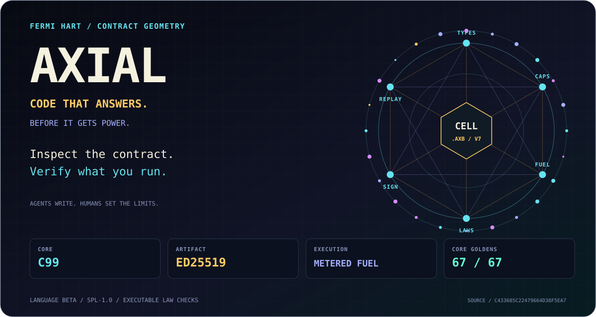
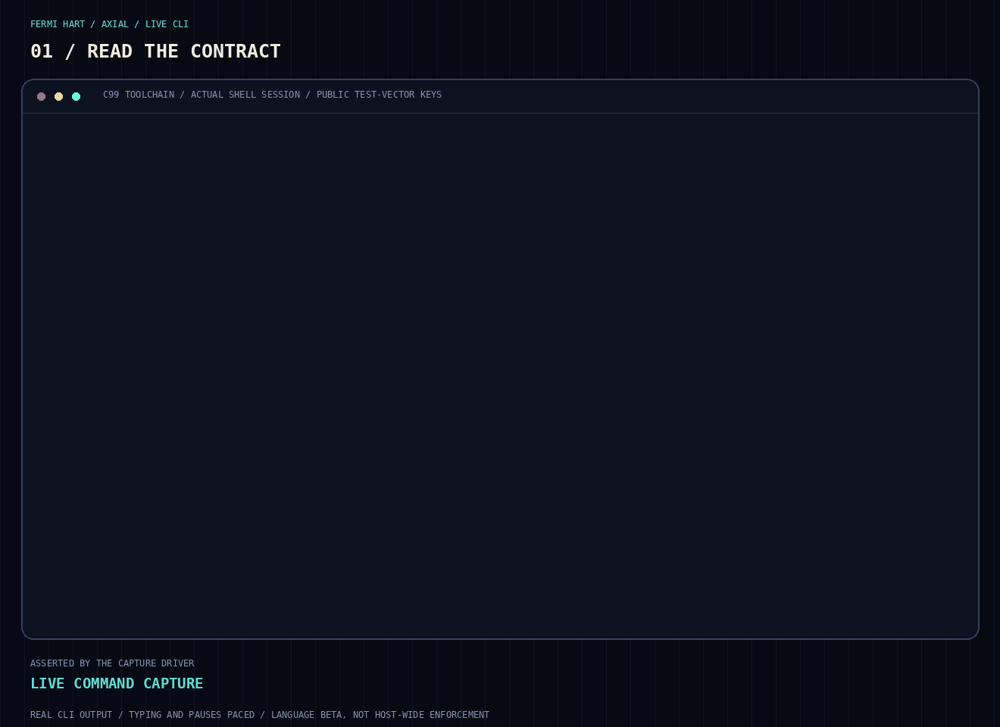
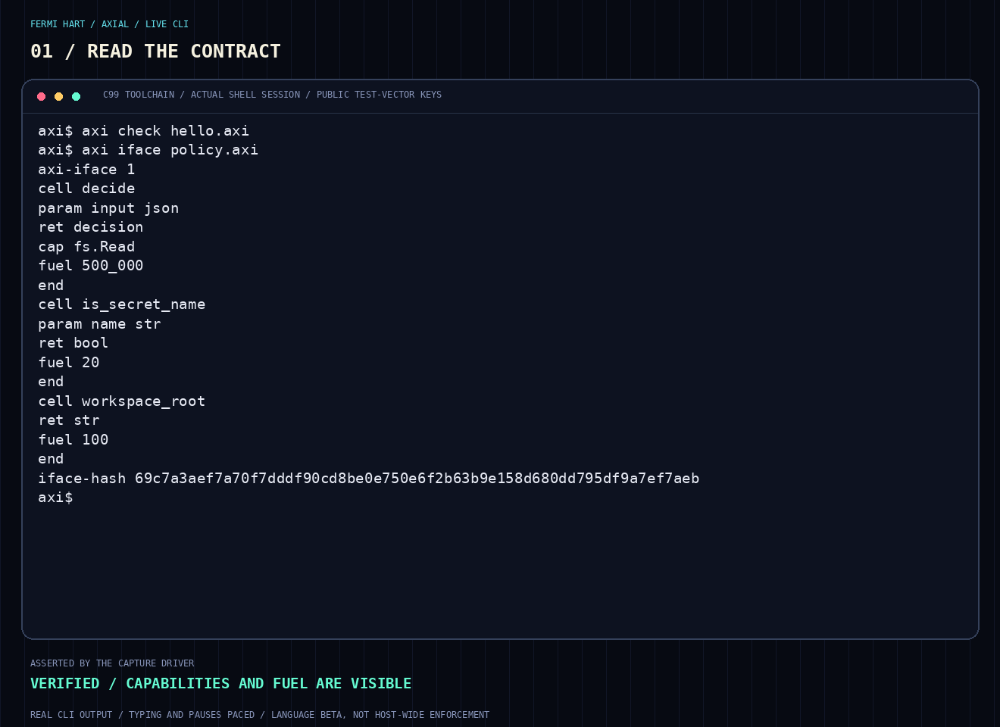
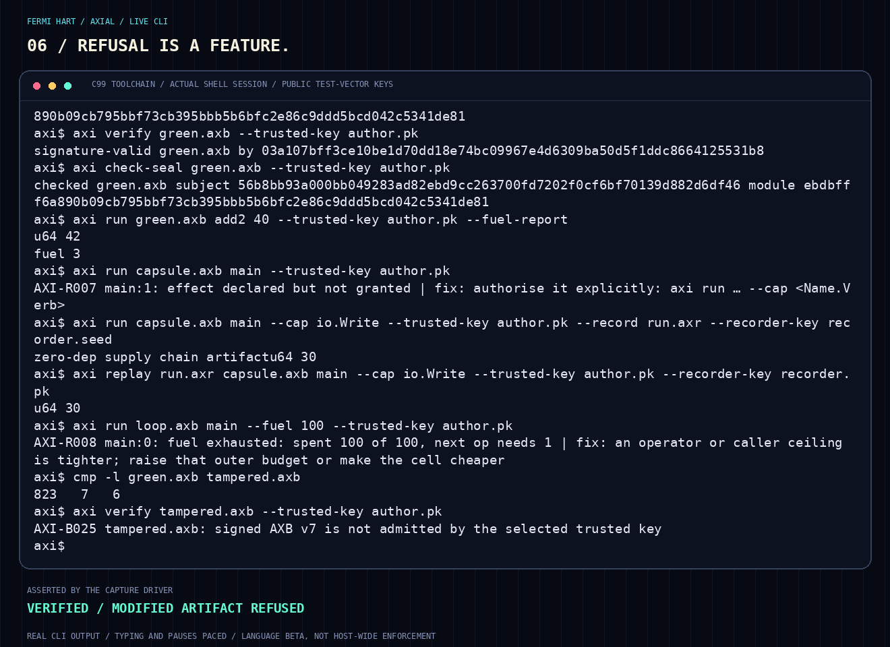
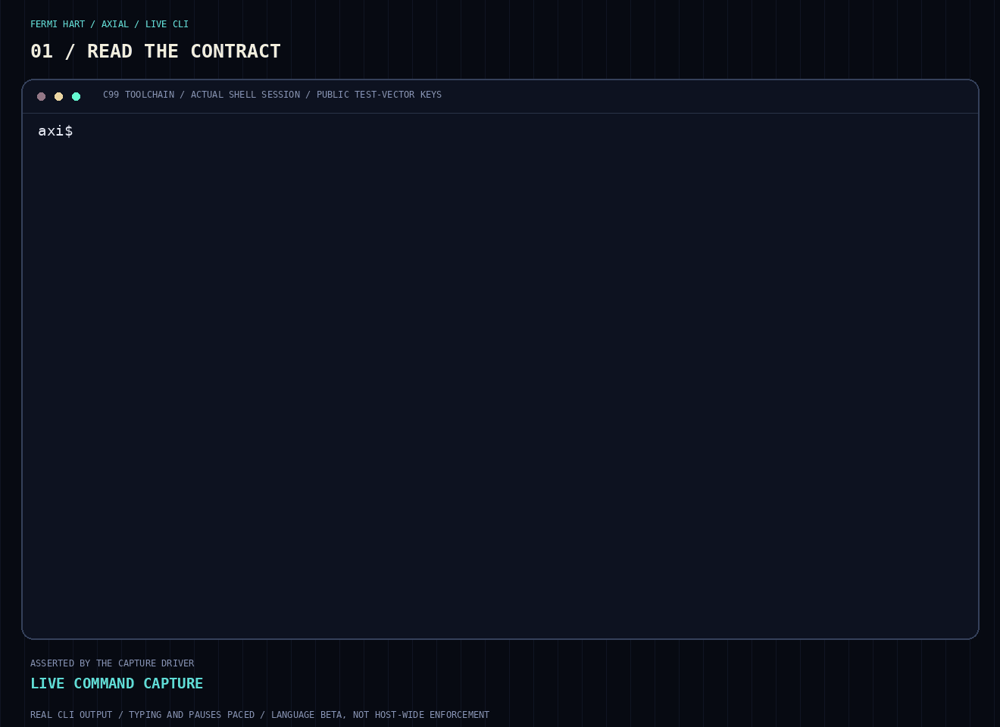

<!-- SPDX-License-Identifier: LicenseRef-SPL-1.0 -->
<!-- Copyright (c) 2026, F E R M I ∞ H A R T <contact@fermihart.com> -->

<p align="center">
  <picture>
    <source media="(max-width: 600px)" srcset="website/assets/hero-cell-mobile.svg">
    
  </picture>
</p>

<h1 align="center">Axial</h1>
<p align="center">
  <strong>Code that answers. Before it gets power.</strong><br>
  Agents write. Humans set the limits. Axial checks the contract.
</p>
<p align="center">
  <a href="#watch-the-contract-become-an-artifact">WATCH IT RUN</a> ·
  <a href="#build-it-ask-it-questions">BUILD IT</a> ·
  <a href="https://fermihart.github.io/axial/">OPEN THE WEBSITE</a> ·
  <a href="docs/SPEC-GRAMMAR.md">READ THE LANGUAGE</a> ·
  <a href="website/index.html">STANDALONE PAGE SOURCE</a>
</p>

Agents can write a function faster than you can finish reading it.
That is extraordinary. It also changes the question that matters.

**Not just: does this code work?**

**What will it be allowed to do when it runs?**

Which effects can it request? How much VM work can it spend? Who signed
these exact bytes? Which executable laws passed before publication?
Can you replay a recorded invocation under the right trust anchors?

Axial makes those questions part of the engineering surface: inspectable
contracts, explicit effect grants, deterministic instruction fuel, signed
artifacts, and executable law checks. A small C99 toolchain for a world
where producing code is easy—and granting it authority should be deliberate.

## Watch the contract become an artifact.

<p align="center">
  <picture>
    <source media="(prefers-reduced-motion: reduce)" srcset="website/assets/runtime-guards.png">
    
  </picture>
</p>

<p align="center"><em>Actual compiled CLI output from an actual shell session.
Typing and pauses are paced for readability. The keys are public test
vectors, not production credentials. <a href="website/assets/axial-in-action.gif">Open the full animation</a>.</em></p>

| Ask the question | Watch the answer |
|---|---|
| What is the contract? | `axi iface` derives types, capability requirements and fuel declarations. |
| Did the law pass? | A false `law_*` returns a diagnostic and emits no new artifact; a green case seals. |
| Who signed these bytes? | `axi verify` checks against an explicitly selected producer key. |
| Were the checked laws re-run? | `axi check-seal` re-executes the certificate's laws. |
| Was the effect granted? | A declared but ungranted `io.Write` is refused. |
| Can this run be reconstructed? | A distinct recorder identity signs an episode; replay checks its bound invocation and result. |
| What happens at the boundary? | A loop stops at its VM fuel ceiling. A one-bit modified artifact is refused. |

## Small enough to inspect. Precise enough to question.

The unit is a **cell**: a function with a declared interface and execution
budget. Here is a real source example from this tree:

```axi
cell hello : fn(a: u64, b: u64) -> u64
  fuel 10_000
  pure
{
  let n = a + b
  ret n
}
```

No invented syntax. Run `axi check examples/hello.axi`, then inspect a
larger contract with `axi iface examples/policy.axi`.

<details>
<summary><strong>Open the actual derived contract</strong></summary>



</details>

The interface helps focus review. It does not tell you that the function
is correct for every input, that its policy is wise, or that a host adapter
is trustworthy. Those are different questions—and Axial keeps them distinct.

## A signature is not a passing law.

**Authorship and checked behavior are not interchangeable.**

`axi seal` executes the `law_*` cells on the VM before emitting a checked,
signed artifact. A false law, a trapping law, or no laws means refusal.
`axi verify` checks producer authentication; `axi check-seal` re-executes
the checked laws. Signed but unchecked artifacts are a separate state.

These are **executable checks over stated cases**, not formal mathematical
proofs of all behavior. A signature authenticates an artifact under the
operator's selected key; it does not make the signer benevolent.

The module travels as one `.axb` file. Trust anchors remain external and
explicit. Replay evidence is a separate signed episode, with a recorder
identity distinct from the producer.

## Power is granted. Not guessed.

A capability declaration is only one side of the decision. In the CLI
effect path, the operator must also grant the effect. A module requesting
`io.Write` does not automatically receive it.

Fuel gives VM instruction work a deterministic price. Exhaustion is a
diagnostic, not an indefinitely running VM loop. Host calls and integrations
still have their own assumptions: fuel is not a universal wall-clock or
host-process security boundary.

<p align="center">
  <a href="website/assets/runtime-guards.png"></a>
</p>

## Five decisions. A real embedding demo.

<p align="center">
  <picture>
    <source media="(prefers-reduced-motion: reduce)" srcset="website/assets/policy.png">
    
  </picture>
</p>

The sample evaluates five requests and reports both decisions and fuel.
The visible `sed` command selects the verdict section; it does not rewrite
the results. `rm` and `export` are **requests evaluated by the example**,
not host commands being executed or intercepted by this recording.

This demo uses the internal compatibility embedding API. The declared
[public v1 embedding profile](docs/BETA-LANGUAGE.md) is pure/CAP-free and
has a [four-function C surface](include/axial/axi_embed_v1.h). Do not confuse
the two. An embedding host must actually honor a policy's decision; the
example is not a universal command sandbox or hardened filesystem policy.

## Build it. Ask it questions.

The product uses a C99 compiler, the standard host libraries, and vendored
cryptography. No package registry, cloud service, or account is required
to build and run it. The original golden gate and demos use POSIX build
tools. Source-identity and full audit gates also require Python 3.

```sh
git clone https://github.com/fermihart/axial.git
cd axial
make dev
./build/axi check examples/hello.axi
./build/axi iface examples/policy.axi
make gate-fast
make demo && sh scripts/jash_policy_demo.sh
sh scripts/demo-supply-chain.sh
```

`make gate-fast` runs the **67 original host golden checks**: lexer, parser,
canonical form, types, interfaces, hash vectors, bytecode round trips and
runtime cases. It is not the full audit or a security certification. The media
capture separately asserts the seal, grant, replay, tamper and fuel cases
shown above.

### Full audit and migration contracts

The original 67 goldens remain available through `make gate-fast`. The full
`make gate` also covers signed CLI effects/replay, compiler quotas, exact
decimal conversion, C API boundaries, allocation and I/O failures, local
authority, worker IPC, checker source identity and the recorded public ABI.
It requires Python 3, POSIX threads and a Linux host that permits local Unix
sequenced-packet sockets and the authority test's real UID transitions.
`AUTHORITY_RUNNER=sudo` elevates only two already-built test executables;
they drop to real UID 1000 / effective UID 1001 before exercising private
temporary stores. Compilation runs as the invoking user. If the process
already has suitable credentials, use the default `AUTHORITY_RUNNER=direct`.
An unavailable required test fails explicitly. All fixtures use public
deterministic test identities. [Gate commands and scope](docs/audit80/gates.md).

<details>
<summary><strong>80-wave audit: retained implementation and migration notes</strong></summary>

The [W41–W80 report](docs/audit80/REPORT.md) continues the
[first 40 waves](docs/audit40/REPORT.md), with checkpoints every ten waves.
It closes the documented source-lowering, string, numeric-conversion and
compiler-budget gaps, introduces an opt-in host-local authority profile,
and fixes deep-call stack exhaustion and the SHA-NI first-use cache race.
Contract generation now projects the interface once per module. The
[measurements and raw evidence](docs/audit80/evidence/README.md) distinguish
numeric helpers, contract generation and runtime/context workloads, including
the adverse context-creation results. The CI runs normal, optimized and
ASan/UBSan gates plus a separate ThreadSanitizer job. The optional `release`
target remains a portable `-O2` build.

The public embed header and recorded ABI bytes are unchanged. The corrected
checker has a new source identity: artifacts carrying an old CHECKED seal
must be explicitly re-executed and resealed, including when admitted under
SIGNATURE_VALID. Ordinary signed artifacts without seals keep their existing
framing. CLI input files must be regular files of at most 64 MiB. Compiler
commands have a default 256-MiB invocation quota, configurable with
`--compile-mem BYTES` after the required file arguments; the optional
`--compile-mem-report` emits a JSON memory report. See
[migration notes](docs/audit80/migration.md) before recompiling old decimal
literals, escaped strings or CHECKED artifacts.

</details>

<details>
<summary><strong>Reproduce the captures instead of trusting the pictures</strong></summary>

Presentation tooling additionally needs Python 3, Pillow, `pyte`, Bash,
Fontconfig and DejaVu Sans Mono:

```sh
python3 tools/presentation.py
python3 tools/presentation.py --check
```

The helper reruns the host gate, uses a private workspace and test-vector
identities, drives the real CLI, and validates the expected successes and
refusals before rendering. It rejects stale source fingerprints or mixed
capture sessions. Raw transcripts, modules, episodes and key files are not
published. Regeneration reproduces the behavior, not necessarily identical
animation timings or media bytes.

</details>

## The boundary is part of the product.

This is the **language/toolchain beta**. The tree contains the grammar,
checker, compiler, bytecode, VM, fuel, effect machinery, signed modules,
sealing, replay and embedding implementations.

It does **not** establish boot-rooted attestation, universal mediation of
host mutations, confidential receipts, an externally certified trusted
runner, or production readiness. Keep the declared embedding profile and
its limits in view. Read [BETA-LANGUAGE.md](docs/BETA-LANGUAGE.md),
[OVERVIEW.md](docs/OVERVIEW.md), and [the normative grammar](docs/SPEC-GRAMMAR.md).

**Let agents move fast. Keep authority deliberate.**

## Inside the box

| Path | Purpose |
|---|---|
| `src/` | Language, compiler, VM, signatures, effects, replay and embedding implementations |
| `include/axial/`, `abi/` | Public C header and declared ABI profile |
| `vendor/` | Vendored cryptographic implementation |
| `examples/`, `tests/` | Source examples, golden fixtures and additional focused cases |
| `scripts/` | Policy and signed supply-chain demos |
| `tools/check.sh` | Public host gate |
| `tools/presentation.py` | Real-command capture and curated media validation |
| `website/` | Standalone responsive presentation; static files, no trackers or external requests |

## License

Sovereign Public License 1.0: [LICENSE](LICENSE), `LicenseRef-SPL-1.0`.
The original copyright and permission notice are retained.
