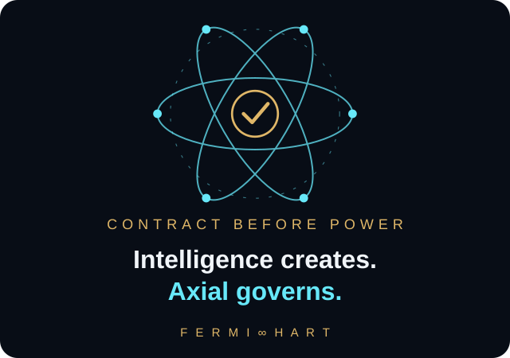

# AXIAL — The Trust Layer for the Agentic Economy

  

## Investor brief and market analysis

[AXIAL — Pitch e Mercado (PDF, PT-BR)](AXIAL_Pitch_e_Mercado.pdf)

November 27, 2026 · 11 pages. Institutional pitch, sourced market indicators, competitive positioning, proposed product lines and target segments, illustrative pricing and revenue scenarios, and go-to-market strategy.

The proposal is not a statement of production qualification, existing partnerships, contracted revenue or certification. The frozen pure public embedding profile and experimental authority profiles remain distinct. See [the beta scope](../docs/BETA-LANGUAGE.md).

The original visual motif is available as [scalable SVG artwork](contract-before-power.svg).

**Contract before power.**

F E R M I ∞ H A R T
